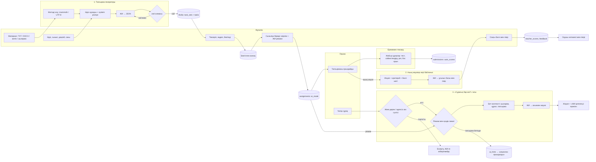

# Пайдаланушы әрекеті → кіріс → өңдеу → шығыс

| Функция | Кіріс | Өңдеу | Шығыс |
| --- | --- | --- | --- |
| Тапсырма генераторы | материал, әдіс, сынып, деңгей, саны, оқу мақсаты | ЖИ құрылымды JSON қайтарады → zod тексереді → сай болмаса қатесін айтып бір рет қайта сұрайды | тапсырмалар жинағы (жоба), мұғалім бекіткенше оқушыға көрінбейді |
| Ережемен тексеру | оқушы жауаптары, дұрыс жауап | `scoreTask` (`src/lib/grading.ts`) | жабық сұрақтар балы, «жиі жіберілген қателер» |
| Ашық жауапқа кері байланыс | оқушы жауабы, критерий, балл шегі | ЖИ JSON → zod → балл шегімен қиылады | ұсыныс балы мен пікір; соңғы балды мұғалім қояды |
| Чат | сұрақ, беттің мекенжайы | сүзгі → режим → лимит → контекст → ЖИ ағыны | жауап; тапсырма бетінде «кеңеспен орындалды» белгісі |
| Өлең өлшегіш, кейіпкер картасы | өлең жолдары / байланыстар | ереже (`src/lib/poem.ts`, `compareMap`) | буын саны, ұйқас, «табылған байланыс 4 / 6» |
